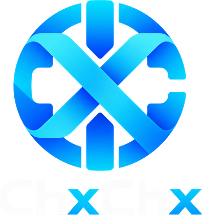
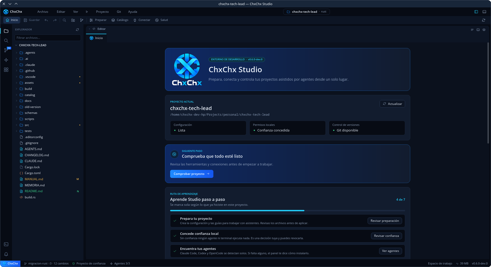
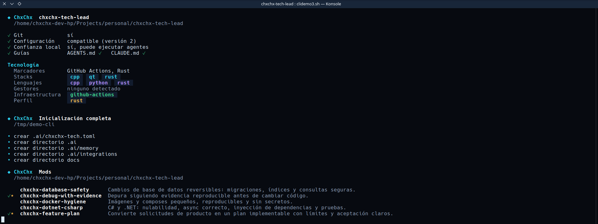

<p align="center">
  
</p>

<h1 align="center">ChxChx Tech Lead</h1>

<p align="center">
  <strong>Prepara, conecta y controla tus proyectos asistidos por agentes de IA, desde un solo lugar.</strong><br>
  Un control plane local, nativo y ligero: CLI, TUI y un Studio de escritorio, todo en Rust.
</p>

<p align="center">
  <a href="https://github.com/chxchx-dev/chxchx-tech-lead/actions/workflows/rust-product.yml"></a>
  
  
  
</p>

<p align="center">
  
</p>

---

## ¿Qué es?

ChxChx prepara un repositorio para trabajar con agentes (Claude Code, Codex, OpenCode) y te da las herramientas
para usarlos con criterio:

- **Prepara** el proyecto: configuración, guías (`AGENTS.md`, `CLAUDE.md`), skills, Tech Packs y Mods, siempre con
  **vista previa, respaldo y reversión**.
- **Conecta** tus asistentes con las herramientas del proyecto (MCP) usando sus CLI oficiales.
- **Controla** lo que cada agente puede hacer: nada se ejecuta sin la **confianza local** que tú concedes.
- **Trabaja** con ellos sin salir de la aplicación: chat visual con permisos, terminales reales, editor y Git.

No es un framework de agentes: es el orquestador que los prepara, los lanza y te deja ver y aprobar lo que hacen.

## Tres interfaces, un mismo núcleo

Las tres leen el mismo modelo del proyecto y comparten la lógica, así que ven y hacen lo mismo.

| | Para qué | Cómo se abre |
|---|---|---|
| **Studio** | Escritorio: editor, Git, agentes, chat y terminales en paneles que acomodas | `chxchx-studio` |
| **TUI** | Un tablero rápido dentro de tu terminal | `chxchx-tech tui .` |
| **CLI** | Automatización y scripts, con salida JSON versionada | `chxchx-tech <comando>` |

## Studio

### Agentes, chat y terminales

Cada agente se abre de dos formas, lado a lado: un **chat visual** y una **terminal real** con su propia interfaz.

- **Chat visual** con permisos en vivo (permitir, permitir y recordar, denegar), niveles de acceso (solo lectura,
  editar, editar y ejecutar, acceso total), red, modelo y esfuerzo a tu elección.
- **Uso a la vista:** tokens, coste, contexto y límites del plan; el contexto se libera solo al llegar al 90 %.
- **Imágenes:** pega una captura (`Ctrl+V`), arrástrala o adjúntala; se reduce a lo que el modelo aprovecha y el
  agente va directo a lo que muestra.
- **Modelos locales (Ollama):** una pestaña que diagnostica tu equipo (memoria, GPU, disco), recomienda los modelos
  que caben y los instala y conecta a OpenCode con progreso, vista previa y respaldo.
- **Terminal real:** emulación VT completa con colores, historial, teclado entero y varias sesiones.
- **Pestañas y paneles, como en VS Code:** chats, terminales y el editor conviven como pestañas de un mismo grupo;
  saca una pestaña a su propio panel con un clic, o arrastra un panel al borde de otro para dividir y al centro
  para unirlo como pestañas. Se redimensionan y maximizan.

<p align="center">
  
</p>

### Editor y Git

Un editor con resaltado de sintaxis, búsqueda en el archivo y en el proyecto, y guardado con respaldo. Git está
integrado: cambios por grupos, historial con grafo, ramas, stash y un **plan de commits** que reparte lo
pendiente en commits claros con mensajes Conventional Commits, sin enviar nada a ningún servicio.

<p align="center">
  
  
</p>

### Catálogo del proyecto

Skills, Tech Packs y Mods que guían a tus agentes. Se recomiendan según el stack detectado y cada cambio se
previsualiza antes de aplicarse.

<p align="center">
  
</p>

Además: una **ruta de aprendizaje** en la página de inicio que se marca sola según lo que ya hiciste.

## TUI

<p align="center">
  
</p>

## CLI

Cada comando que modifica archivos muestra primero una vista previa; `--apply` confirma. La salida de `status
--json` cumple el esquema versionado [`schemas/project-overview-v1.schema.json`](schemas/project-overview-v1.schema.json).

<p align="center">
  
</p>

| Comando | Qué hace |
|---|---|
| `status` | Resume el proyecto sin escribir ni iniciar procesos |
| `init` | Previsualiza (y con `--apply` crea) configuración y guías |
| `rollback` | Restaura los archivos administrados desde el último respaldo |
| `workspace` | Gestiona la confianza local del proyecto |
| `skills` · `packs` · `mods` | Catálogo de skills, Tech Packs y Mods |
| `integrate` | Configura servidores MCP para los clientes instalados |
| `doctor` | Diagnostica herramientas y configuración sin ejecutar comandos |
| `projects` | Proyectos registrados |
| `tui` · `studio` | Abren las otras interfaces |

## Instalación

### Windows

Cada push genera el artefacto **`chxchx-rust-windows-x86_64`** (workflow *Rust product builds*) con
`chxchx-studio.exe` y `chxchx-tech.exe`; no requiere instalar nada más. Para compilar desde el repositorio:

```powershell
./scripts/studio-rust.ps1
```

### Linux y macOS

Necesitas [Rust](https://rustup.rs). En Linux, las bibliotecas de ventana:

```bash
# Debian/Ubuntu
sudo apt-get install libwayland-dev libx11-dev libxkbcommon-dev libxcb1-dev libxcursor-dev libxi-dev libxrandr-dev
```

```bash
cargo build --release
./target/release/chxchx-studio .         # abre Studio sobre el proyecto actual
./target/release/chxchx-tech status .    # o usa el CLI
# o, de una vez: ./scripts/studio-rust.sh
```

> **Nota:** el chat visual usa por ahora el CLI de Python de [`old-version/`](old-version/)
> (`cd old-version && uv sync`) hasta que `agent chat` se porte a Rust. Studio lo busca solo; también puedes
> indicar su ruta con `CHXCHX_TECH_CLI`. El resto del producto no lo necesita.

## Seguridad

- **Confianza local:** ningún agente ni terminal ejecuta procesos configurados sin que concedas confianza al proyecto.
- **Vista previa y respaldo:** toda modificación muestra el cambio antes y deja una copia para revertir.
- **Sin secretos:** no se guardan contraseñas, tokens ni `.env`; MCP y el contenido externo se tratan como no confiables.
- **Directorios acotados:** el directorio de trabajo de un agente no puede salir del proyecto.

## Ligero por diseño

Studio es un binario nativo sin navegador embebido: en reposo ocupa unos 40 MB de RAM. Devuelve al sistema la memoria que
libera, recorta lo que el chat no necesita y lanza los agentes con ajustes que reducen su huella. La guía
[MEMORIA.md](MEMORIA.md) explica cada técnica y cómo comprobarla.

## Estructura del repositorio

```
.
├── src/            Núcleo y las tres interfaces (features / integrations / interfaces)
├── tests/          Pruebas de capacidades de extremo a extremo
├── catalog/        Skills, Tech Packs y Mods que se incrustan en el binario
├── assets/         Marca, perfiles y capturas
├── schemas/        Contratos JSON versionados
├── scripts/        Arranque y validación
├── MANUAL.md       Manual técnico: capacidades, seguridad y decisiones
├── MEMORIA.md      Guía de gestión de memoria
└── old-version/    Versión anterior (Python + C++/Qt), solo consulta hasta eliminarla
```

## Desarrollo

```bash
cargo fmt --all -- --check
cargo clippy --locked --all-targets -- -D warnings
cargo test --locked
```

El código sigue una separación estricta: las interfaces solo componen pantallas y llaman a casos de uso;
los procesos e integraciones externas viven en `integrations/`. Más reglas en [AGENTS.md](AGENTS.md).

## Estado

Versión `0.6.0-dev` en la rama `migracion-rust`: no sustituye todavía a la instalación 0.5.x. Pendiente: portar
`agent chat` a Rust (hoy usa el CLI de Python), guardar la disposición de paneles entre sesiones y completar la QA
en macOS y Linux.
