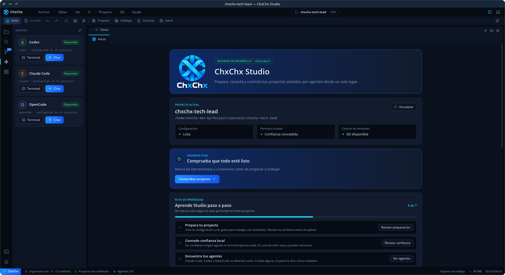
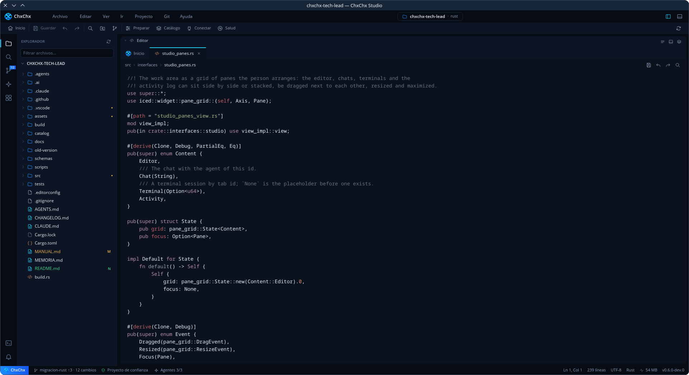
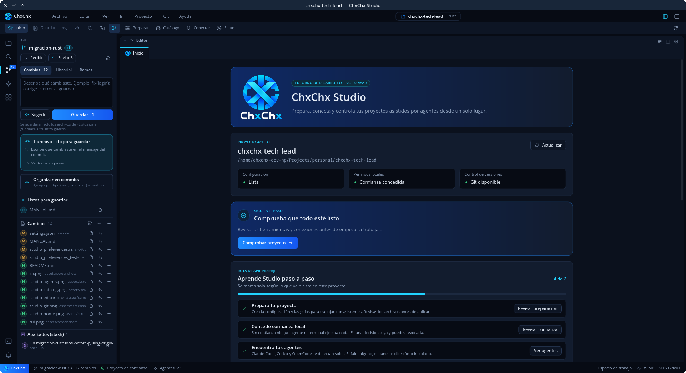
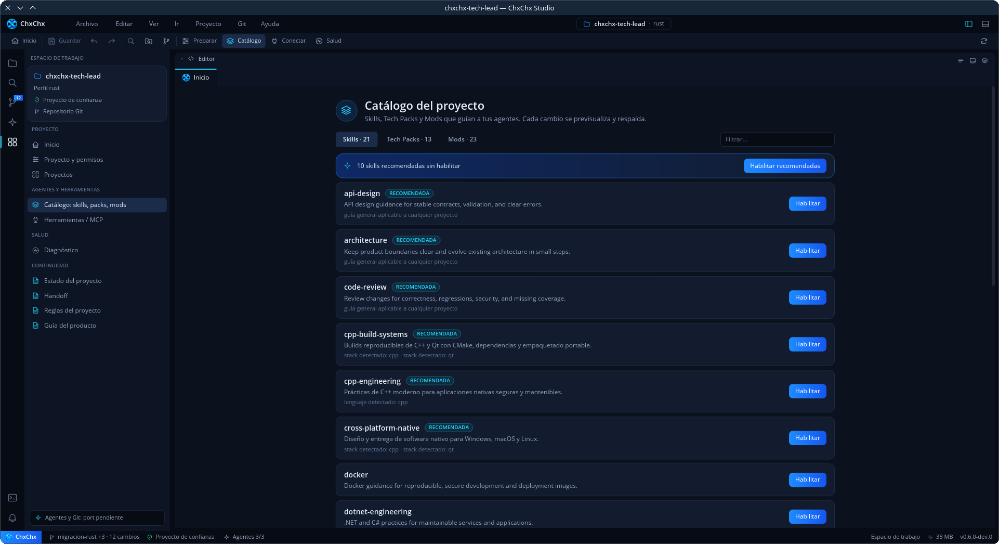
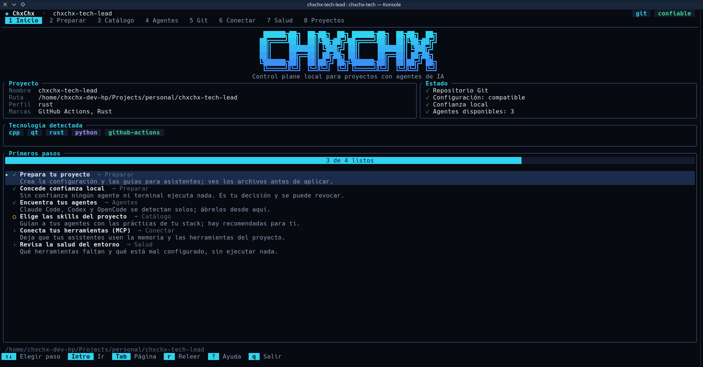
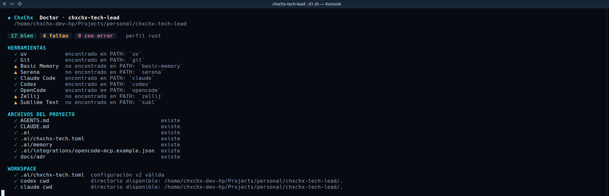
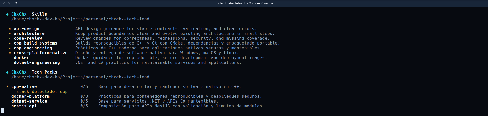

<p align="center">
  
</p>

<h1 align="center">ChxChx Tech Lead</h1>

<p align="center">
  <strong>Prepara, conecta y controla tus proyectos asistidos por agentes de IA, desde un solo lugar.</strong><br>
  Un control plane local, nativo y ligero: CLI, TUI y un Studio de escritorio, todo en Rust.
</p>

<p align="center">
  <a href="https://github.com/chxchx-dev/chxchx-tech-lead/actions/workflows/rust-product.yml"></a>
  
  
  
</p>

<p align="center">
  
</p>

---

## ¿Qué es?

ChxChx prepara un repositorio para trabajar con agentes (Claude Code, Codex, OpenCode) y te da las herramientas
para usarlos con criterio:

- **Prepara** el proyecto: configuración, guías (`AGENTS.md`, `CLAUDE.md`), skills, Tech Packs y Mods, siempre con
  **vista previa, respaldo y reversión**.
- **Conecta** tus asistentes con las herramientas del proyecto (MCP) usando sus CLI oficiales.
- **Controla** lo que cada agente puede hacer: nada se ejecuta sin la **confianza local** que tú concedes.
- **Trabaja** con ellos sin salir de la aplicación: chat visual con permisos, terminales reales, editor y Git.

No es un framework de agentes: es el orquestador que los prepara, los lanza y te deja ver y aprobar lo que hacen.

## Un solo comando, tres interfaces

`chxchx-tech` (o su nombre corto `chxchx`) abre todo: **sin argumentos** abre Studio si hay escritorio y, si no, el TUI;
con una carpeta (`chxchx-tech ~/mi-proyecto`) abre ese proyecto. De ahí salen las tres interfaces, que leen el mismo modelo
del proyecto y comparten la lógica:

| | Para qué | Cómo se abre |
|---|---|---|
| **Studio** | Escritorio: editor, Git, agentes, chat y terminales en paneles que acomodas | `chxchx-tech studio .` · `gui` |
| **TUI** | Un tablero rápido dentro de tu terminal | `chxchx-tech tui .` · `t` |
| **CLI** | Automatización y scripts, con salida JSON versionada | `chxchx-tech <comando>` |

Atajos: `st` (status) · `dr` (doctor) · `sk` (skills) · `ws` (workspace) · `pr` (projects). Los comandos que aún viven en el
CLI de Python (`agent`, `bridge`, `local-models`, `run`, `ci`, `deploy`…) también se escriben con `chxchx-tech`: los ejecuta
el CLI que acompaña a la instalación, así que no hay que recordar dos programas.

## Studio

### Agentes, chat y terminales

Cada agente se abre de dos formas, lado a lado: un **chat visual** y una **terminal real** con su propia interfaz.

- **Chat visual** con permisos en vivo (permitir, permitir y recordar, denegar), niveles de acceso (solo lectura,
  editar, editar y ejecutar, acceso total), red, modelo y esfuerzo a tu elección.
- **Uso a la vista:** tokens, coste, contexto y límites del plan; el contexto se libera solo al llegar al 90 %.
- **Imágenes:** pega una captura (`Ctrl+V`), arrástrala o adjúntala; se reduce a lo que el modelo aprovecha y el
  agente va directo a lo que muestra.
- **Modelos locales (Ollama):** una pestaña que diagnostica tu equipo (memoria, GPU, disco), recomienda los modelos
  que caben y los instala y conecta a OpenCode con progreso, vista previa y respaldo.
- **Conectores MCP:** da manos a tus agentes en tus apps —Excel, Power BI, Word, Google Sheets, PostgreSQL, SQLite o un servidor propio—
  desde la página *Herramientas / MCP*. Se configuran en el proyecto para Claude Code, Codex y OpenCode, con vista previa del
  archivo exacto, respaldo, y sin guardar nunca una clave (solo el nombre de la variable de entorno).
- **Terminal real:** emulación VT completa con colores, historial, teclado entero y varias sesiones.
- **Pestañas y paneles, como en VS Code:** chats, terminales y el editor conviven como pestañas de un mismo grupo;
  saca una pestaña a su propio panel con un clic, o arrastra un panel al borde de otro para dividir y al centro
  para unirlo como pestañas. Se redimensionan y maximizan.

<p align="center">
  
</p>

### Editor y Git

Un editor con resaltado de sintaxis, búsqueda en el archivo y en el proyecto, y guardado con respaldo. Git está
integrado: cambios por grupos, historial con grafo, ramas, stash y un **plan de commits** que reparte lo
pendiente en commits claros con mensajes Conventional Commits, sin enviar nada a ningún servicio.

<p align="center">
  
  
</p>

### Catálogo del proyecto

Skills, Tech Packs y Mods que guían a tus agentes. Se recomiendan según el stack detectado y cada cambio se
previsualiza antes de aplicarse.

<p align="center">
  
</p>

Guía de los conectores (Excel, Power BI, bases de datos…): [CONECTORES.md](CONECTORES.md).

Además: una **ruta de aprendizaje** en la página de inicio que se marca sola según lo que ya hiciste.

## TUI

El mismo producto dentro de tu terminal, con ocho páginas (`Tab` o `1`-`8`, también con clic) y siempre vista previa antes
de cambiar nada. Abre con `chxchx-tech tui .`.

- **Inicio:** el proyecto, su estado, la tecnología detectada y los primeros pasos con una barra de progreso.
- **Preparar** y **Conectar:** preparar el proyecto, dar o revocar la confianza, restaurar un respaldo y conectar MCP; en
  *Conectar* eliges Excel, Power BI, bases de datos… y `Intro` añade o quita el conector. Cada acción abre una vista previa y
  `y` la aplica.
- **Catálogo:** skills, Tech Packs y Mods con las recomendadas para tu stack (★); `Intro` activa o quita, `a` aplica las
  recomendadas.
- **Agentes:** Claude Code, Codex y OpenCode; `Intro` abre el agente en esta misma terminal y vuelves al panel al salir.
- **Git:** rama, adelantos, cambios y el historial reciente.
- **Salud** y **Proyectos:** el diagnóstico del entorno y los proyectos registrados, con sincronización en un paso.

<p align="center">
  
</p>

## CLI

Cada comando que modifica archivos muestra primero una vista previa; `--apply` confirma. En una terminal la salida va con color,
símbolos y tablas; si la rediriges o usas `NO_COLOR`, sigue siendo el texto plano de siempre, listo para scripts. La salida de `status
--json` cumple el esquema versionado [`schemas/project-overview-v1.schema.json`](schemas/project-overview-v1.schema.json).

<p align="center">
  
</p>
<p align="center">
  
  
</p>

| Comando | Qué hace |
|---|---|
| `status` | Resume el proyecto sin escribir ni iniciar procesos |
| `init` | Previsualiza (y con `--apply` crea) configuración y guías |
| `rollback` | Restaura los archivos administrados desde el último respaldo |
| `workspace` | Gestiona la confianza local del proyecto |
| `skills` · `packs` · `mods` | Catálogo de skills, Tech Packs y Mods |
| `integrate` | Configura los servidores de memoria y código (basic-memory, Serena) |
| `connectors` (`conn`) | Conecta tus agentes con Excel, Power BI, bases de datos… (`list`, `add`, `remove`, `custom`); ver [CONECTORES.md](CONECTORES.md) |
| `doctor` | Diagnostica herramientas y configuración sin ejecutar comandos |
| `projects` | Proyectos registrados |
| `tui` · `studio` | Abren las otras interfaces (también `chxchx-tech` a secas) |

## Instalación

### Windows

La release ofrece un [MSI x64 por usuario](https://github.com/chxchx-dev/chxchx-tech-lead/releases/latest/download/chxchx-studio-windows-x86_64.msi), sin permisos de administrador. La copia versionada de 0.6.3 también está en [GitHub](https://github.com/chxchx-dev/chxchx-tech-lead/blob/dev/installers/windows/v0.6.3/chxchx-studio-windows-x86_64.msi), con su SHA-256 al lado. Como alternativa, `install.ps1` descarga el ZIP y verifica su SHA-256 contra el manifiesto; el ayudante Python descarga `uv` y Python 3.11 si faltan. Ambos métodos instalan Basic Memory y Serena como extras requeridos, así que necesitan Internet.

El MSI se instala en `%LOCALAPPDATA%\Programs\ChxChxStudio\stable-X.Y.Z`. Incluye los ejecutables Rust, el ayudante Python con CPython 3.11.18 y sus paquetes, y `uv.exe`; descarga Basic Memory y Serena durante la instalación. Los shims de sus comandos quedan en PATH. Tanto el MSI como `install.ps1` crean shims para todos los comandos Rust `chxchx-*` incluidos, también los que se añadan en futuras versiones. El workflow añade al manifiesto los paquetes y sus SHA-256 y comprueba el ciclo silencioso de instalar, abrir, actualizar y desinstalar antes de publicarlos. El script de ZIP no modifica una instalación MSI del mismo canal. Por decisión del dueño, los instaladores no llevan firma digital y se destinan al uso personal y conocidos; Windows puede mostrar SmartScreen.

Para seguir instalando con el método actual, usa `-DryRun` antes de modificar el equipo:

```powershell
Invoke-WebRequest https://github.com/chxchx-dev/chxchx-tech-lead/releases/latest/download/install.ps1 -OutFile install.ps1
.\install.ps1 -DryRun
.\install.ps1
```

El ZIP nativo también se publica en Releases para instalaciones existentes. El artefacto **`chxchx-rust-windows-x86_64`** del workflow *Rust product builds* es una compilación de CI, retenida por 14 días, no un instalador. No se publica aún un build nativo para Windows ARM64. Para compilar y validar el MSI desde el repositorio (requiere el SDK de .NET 6, WiX 5.0.2 y `uv`):

```powershell
./scripts/build_windows_msi.ps1 -Channel stable
./scripts/studio-rust.ps1
```

### Linux y macOS

Hay instaladores gráficos para Linux x86_64 y macOS (Apple Silicon e Intel), publicados como archivos descargables en [GitHub Releases](https://github.com/chxchx-dev/chxchx-tech-lead/releases/latest). Los paquetes se generan en CI y su SHA-256 se incluye en `studio-manifest.txt`. La ventana permite verificar descargas sin instalar antes de continuar.

- **macOS:** descarga [Apple Silicon](https://github.com/chxchx-dev/chxchx-tech-lead/releases/latest/download/chxchx-installer-macos-arm64.dmg) o [Intel](https://github.com/chxchx-dev/chxchx-tech-lead/releases/latest/download/chxchx-installer-macos-x86_64.dmg), abre el DMG, copia *ChxChx Installer.app* a Aplicaciones y ejecútalo. La app instala Studio y los comandos en tu usuario. Al no tener certificado Developer ID ni notarización, macOS puede pedir autorizarla la primera vez.
- **Linux x86_64:** descarga [el instalador gráfico](https://github.com/chxchx-dev/chxchx-tech-lead/releases/latest/download/chxchx-installer-linux-x86_64.tar.gz), extráelo desde el gestor de archivos y abre `iniciar-instalador.sh`. Si necesita bibliotecas gráficas, pedirá autorización del sistema; el programa y los comandos quedan en tu usuario.
- En ambos sistemas puedes seleccionar `stable` o `dev`. Basic Memory y Serena son extras requeridos: se descargan durante la instalación, por lo que hace falta conexión a Internet.

Los comandos quedan en `~/.local/bin`. El instalador agrega esa carpeta, sin duplicar el bloque, a los archivos de inicio de Bash, Zsh o Fish; abre una terminal nueva al terminar. Los paquetes incluyen automáticamente los ejecutables CLI Rust `chxchx-*` disponibles, así que futuros comandos siguen el mismo mecanismo. Al desinstalar ChxChx se conserva la ruta porque Basic Memory y Serena también viven ahí.

El instalador de consola sigue disponible para automatización y `--dry-run`:

```bash
curl -fsSL https://github.com/chxchx-dev/chxchx-tech-lead/releases/latest/download/install.sh | bash -s -- --dry-run
```

Necesitas [Rust](https://rustup.rs). En Linux, las bibliotecas de ventana:

```bash
# Debian/Ubuntu
sudo apt-get install libwayland-dev libx11-dev libxkbcommon-dev libxcb1-dev libxcursor-dev libxi-dev libxrandr-dev
```

```bash
cargo build --release
./target/release/chxchx-studio .         # abre Studio sobre el proyecto actual
./target/release/chxchx-tech status .    # o usa el CLI
cargo run --release --features visual-installer --bin chxchx-installer
# o, de una vez: ./scripts/studio-rust.sh
```

> **Nota:** el chat visual usa por ahora el CLI de Python de [`old-version/`](old-version/)
> (`cd old-version && uv sync`) hasta que `agent chat` se porte a Rust. Studio lo busca solo; también puedes
> indicar su ruta con `CHXCHX_TECH_CLI`. El resto del producto no lo necesita.

## Actualizaciones

**Ayuda → Buscar actualizaciones…** consulta el canal que sigue tu instalación (`stable` o `dev`), descarga el
paquete, verifica su SHA-256 y lo instala; tus proyectos y ajustes no cambian. Mantiene **una sola instalación por
canal** (la nueva y, hasta la siguiente actualización, la que estaba abierta): no se acumulan `ChxChx Studio 0.5.2`,
`0.5.3`… una junto a otra. Cada push a `dev` renueva la vista previa `studio-dev-preview` (canal `dev`). Publicar la versión estable: subir un tag `vX.Y.Z` (`git tag v0.6.0 && git push origin v0.6.0`) publica esa versión estable; o Actions →
*Studio release (Rust)* → *Run workflow* para elegir el canal (`dev` o `stable`) y, con `publish` desmarcado, solo armar y revisar los paquetes. Las novedades de cada versión están en [CHANGELOG.md](CHANGELOG.md).

## Seguridad

- **Confianza local:** ningún agente ni terminal ejecuta procesos configurados sin que concedas confianza al proyecto.
- **Vista previa y respaldo:** toda modificación muestra el cambio antes y deja una copia para revertir.
- **Sin secretos:** no se guardan contraseñas, tokens ni `.env`; MCP y el contenido externo se tratan como no confiables.
- **Directorios acotados:** el directorio de trabajo de un agente no puede salir del proyecto.

## Ligero por diseño

Studio es un binario nativo sin navegador embebido: en reposo ocupa unos 40 MB de RAM. Devuelve al sistema la memoria que
libera, recorta lo que el chat no necesita y lanza los agentes con ajustes que reducen su huella. La guía
[MEMORIA.md](MEMORIA.md) explica cada técnica y cómo comprobarla.

## Estructura del repositorio

```
.
├── src/            Núcleo y las tres interfaces (features / integrations / interfaces)
├── tests/          Pruebas de capacidades de extremo a extremo
├── catalog/        Skills, Tech Packs y Mods que se incrustan en el binario
├── assets/         Marca, perfiles y capturas
├── schemas/        Contratos JSON versionados
├── scripts/        Arranque y validación
├── MANUAL.md       Manual técnico: capacidades, seguridad y decisiones
├── MEMORIA.md      Guía de gestión de memoria
├── CONECTORES.md   Guía de los conectores MCP (Excel, Power BI, bases de datos…)
└── old-version/    Solo el CLI de Python que aún sirve el chat, los modelos locales y el actualizador
```

## Desarrollo

```bash
cargo fmt --all -- --check
cargo clippy --locked --all-targets -- -D warnings
cargo test --locked
```

El código sigue una separación estricta: las interfaces solo componen pantallas y llaman a casos de uso;
los procesos e integraciones externas viven en `integrations/`. Más reglas en [AGENTS.md](AGENTS.md).

## Estado

Versión `0.6.3`, el producto en Rust. Pendiente: portar `agent chat` y los modelos locales a Rust (hoy los sirve el CLI de Python de `old-version/`), guardar la disposición de paneles entre sesiones y completar la QA en macOS y Linux.
`agent chat` a Rust (hoy usa el CLI de Python), guardar la disposición de paneles entre sesiones y completar la QA
en macOS y Linux.
